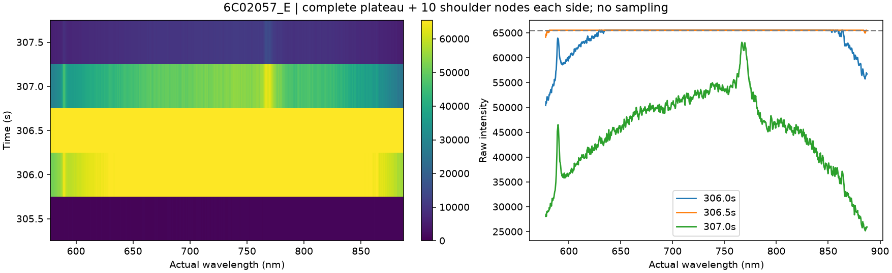
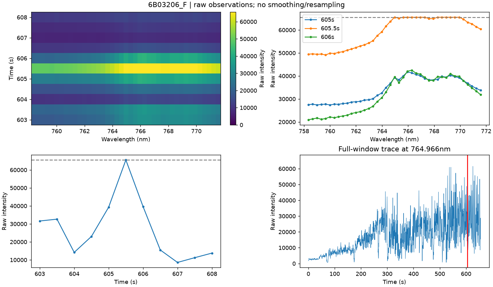
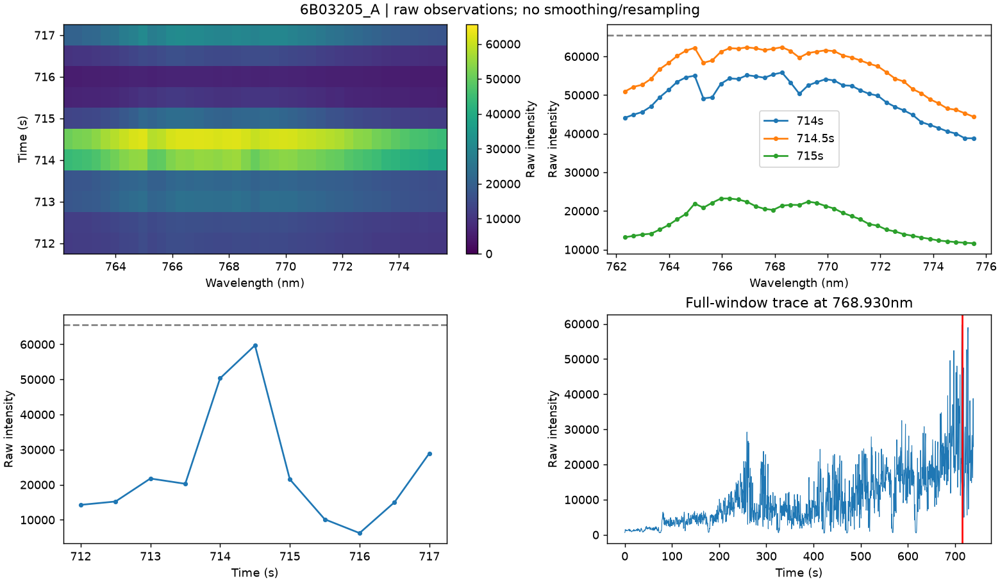

# Q1专项调查总报告：S01–S07 第一轮

日期2026-11-27；工作线A，q1-spectral。用户已明确授权独立调查，未修改main、Q2或共同标准；科学重大决定均Pending，本轮停止于交叉审核前。

## 题目要求、目标和来源

本地官方PDF第3页Q1准确要求：识别处理十炉离散光谱异常、在时间和波长上连续重建，并画全部十炉连续三维图。本轮只调查，尚未完成最终重构和3D连续模型。官方原文核对记录在研究成果/运行核验.json，没有复制整份题目。
十份当前官方XLSB，附件1为修正版，全部文件大小/哈希、sheet、列头与清单核对，分析前后哈希一致。原始数据实际位于项目上级Data/Data及根目录修正版，代码通过--source-root定位；报告不保存个人绝对路径。迁移程序旧loader已单独实测，完整旧生成器没有执行；新程序复用pyxlsb行读取约定并实际跑十炉。

## 实际计算与主要发现

总计27,816,683个光谱点，65535为14,805点，占全十炉点数的0.053223%；这只是观测上限值比例，不是已确认错误率。十炉独立分母见S04。探索评分阈值12产生56,269个内部非65535候选，全部逐点可定位，不能解释为错误数量；12/20/30的敏感性见S05。

|Heat_ID|Points|Point_Percent|Affected_Rows|Components_4|Components_8|Largest_4|
|---|---|---|---|---|---|---|
|6B03205|0|0.0|0|0|0|0|
|6B03206|13|0.00048442083948640953|1|3|3|6|
|6B03270|0|0.0|0|0|0|0|
|6B03271|10|0.00034402801764175673|1|2|2|5|
|6C02057|4168|0.26272909214113493|12|64|64|1593|
|6C02058|5805|0.21115840299499367|40|131|131|1031|
|6C02059|100|0.003141606334735013|7|9|9|38|
|6C02060|326|0.011599231604276915|5|27|27|93|
|6C02107|2110|0.07064953711159914|15|54|54|650|
|6C02108|2273|0.07600311234918497|11|42|42|864|

1. S01复核规模/坐标/显式缺失与先前一致，光谱行重复独立核验；不把“无缺失”推成“无问题”。
2. 两套lambda组内逐值相同，组间同列偏差随位置变化，不能用同列融合，也不能无依据用固定偏移校准。
3. 强度分布、时间变化和波长背景不同，单个全局阈值不能区分真实窄峰与错误。
4. 上限点在时空有多种连通形态，组件定义依4/8邻域而异，本数据两种口径数量相同；不是故障次数，面积不是物理面积。
5. 部分实际案例存在平顶和两侧肩部，支持削顶形态；其他案例证据不足。缺设备量程及未知真峰，不能统一删掉65535。
6. 非65535也有高局部偏离、时间突变和整体变化线索；高分/低分均不能决定有效性。
7. 持续尖锐候选谱线和多波长变化说明平滑不是正常数据的必要条件；需用反例审核防误伤。
8. 全炉中位谱、双向邻域和未来时刻参考可用于离线调查，但不直接作为Q3实时输入。

## 数学方法与建模意义

S01–S06实际使用描述统计、MAD/IQR、原始相邻差、L1/L2与余弦、四邻域探索残差、稀疏图连通和真实lambda近邻距离。没有拟合、插值、平滑、归一化数据集或重采样。
候选检测比较分方向稳健方法、二维共识、低秩+稀疏；候选连续模型比较线性基准、形状保持分片Hermite、张量积样条、删失约束基函数。公式、假设、复杂度与风险见S07方法报告。离散矩阵恢复本身不等于连续函数；普通错误、缺失与截断不应混为同一种恢复任务。

## 代表性案例和反例

每炉A持续候选峰、B时间突变、C未达上限高值、D高局部分数、G整体变化及E/F上限案例实际生成；不存在上限的炉仅提供未截断对照。所有位置和窗口见S06，跨炉最近lambda证据单列。案例类型可重叠，无已认证谱线或已确认错误真值。不能凭波长确认元素。

## 后续验证设计（均未执行）

人工异常注入：可信参考区分峰/背景/时段，点、连续段和二维块，拟种子20261127及多比例/幅度，评价P/R/F1/FPR及谱峰误伤。人工遮蔽：点、时间、lambda、二维块和峰附近，评价MAE/RMSE及峰高、实际nm峰位、面积与形态，近零不乱除。削顶模拟单独用未截断参考峰构造min(x,c)，分别评价截断区与肩部；真实未知上方强度不可由模拟证明已恢复。按炉隔离调参/测试，LOHO为候选，既有十炉EDA不能称盲测。

## 局限、未决事项与阶段边界

数据证据局限：反例为极值选择而非随机抽样；评分仅内部四邻域，边界/平台内部可漏检。物理信息不足：设备量程、曝光、绝对强度标定、工艺阶段、谱线归属及真实传输时间未知。方法未验证：没有检测或重构性能数字，没有最终模型。共同决定未完成：网格策略、可信正常参考区、阈值与验证划分、删失处理和Q3接口均Pending。
需要队友复核：哈希与分母、4/8组件守恒、代表形态及反例、评分误伤风险、时间支持与Q3可用信息。Q1变更提案仅放本线，未写共同问题表或正式决策。
下一步：用户审阅→Q2 Agent交叉复核→两队员共同确定参考区与候选验证设计→获授权后实施注入/遮蔽/削顶验证→再共同选方法。当前不进入正式处理、连续重构或预测训练；不自动推送新成果。

## 可复现入口

代码/运行说明.md列实际命令、依赖和输出对应；研究成果/运行核验.json记录前后源哈希与参数，迁移读取函数实测.json记录旧loader实际执行结果。所有报告、CSV、图均保存在本Q1目录，每个图通过案例或炉号对应代码。完整原始光谱矩阵未保存为交付，不上传官方附件。

## 补充证据与独立口径复核

补充程序实际重读十炉，前后哈希仍一致：新增最负局部分数低点H、G事件整谱曲线与方向比例、E完整平台及两侧各10个节点图。原±20列局部窗可能看不见宽平台肩部，完整图补足这一局限，没有改变平台定义。
发现26对相邻不同波长列在完整炉次逐点完全相同；涉及10炉。位置和完整样本分母见S05_重复波长列证据.csv。这是新增可复核事实；量化、边缘通道记录或处理机制等解释仍未知，不能直接删除这些波长。非65535精确平台的数量、最大段及原值见S05_非上限平台统计.csv，平台也不自动等于异常。
本数据每炉4/8邻域的组件数量相同（并非观察到邻域改变组件数），两种定义仍必须分开说明。经检查，两种口径各自组件点数之和等于65535点数；所有局部分数阈值计数可从最宽候选位置表按分数复算。

## 代表性图形与解读

附件5所选平台连续915个波长节点，远大于最初局部窗；完整肩部图支持讨论截断形态，但不能确认量程或真实峰顶。

附件2选中的65535只有一个波长点，没有平台。它反驳“所有上限点形态相同”，不能据此排除单点削顶。

附件1在768.930 nm的局部极大值反复出现（该列作为局部极大值的时间比例约59.3%），是简单大值/波长差分删点的风险案例；没有确认其元素归属或物理真值。
