# Q1交叉审核精选图册与索引

先看以下12图，不复制旧图文件、不要求重读120图。所有参考区Pending Review，原120图证据保留。

## 1. V02 A参考候选，Pending Review

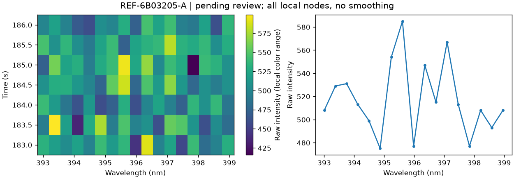

## 2. V02 B参考候选，Pending Review

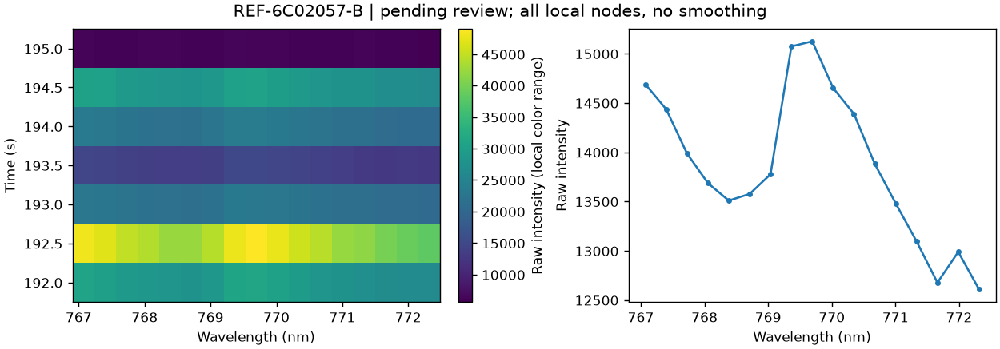

## 3. V02 C参考候选，Pending Review

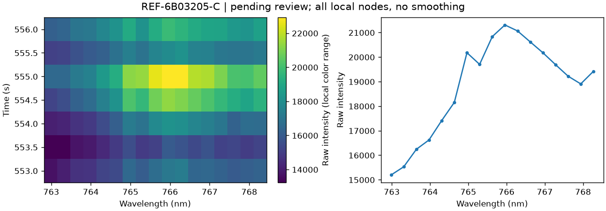

## 4. V02 D参考候选，Pending Review

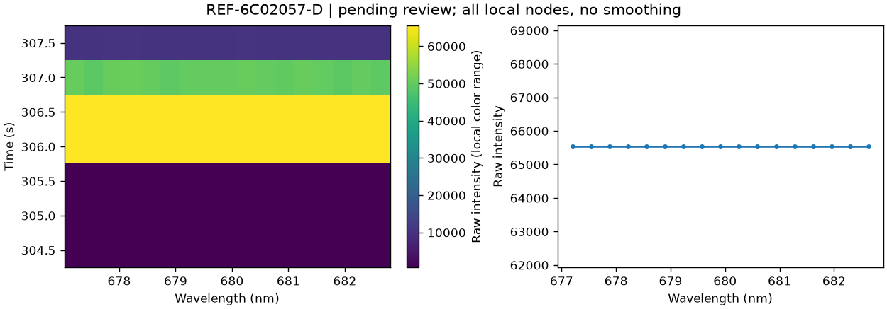

## 5. V02 E参考候选，Pending Review

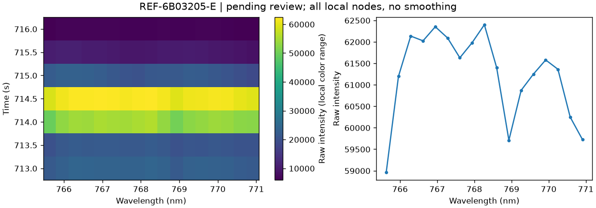

## 6. V02 F参考候选，Pending Review

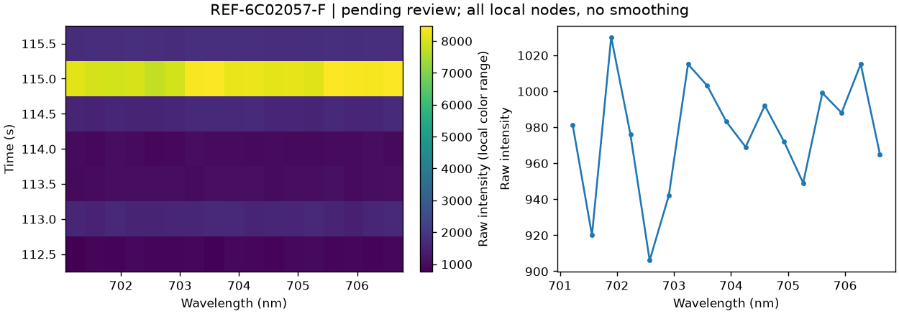

## 7. V02 G参考候选，Pending Review

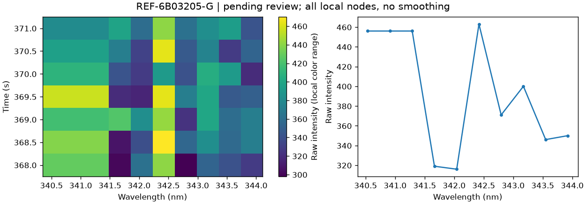

## 8. 915节点宽平台双肩

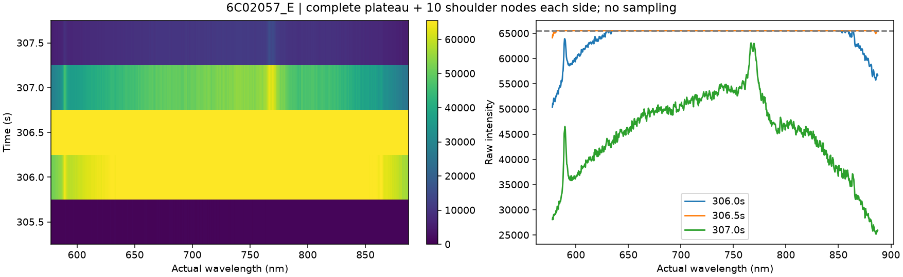

## 9. 单点上限反例

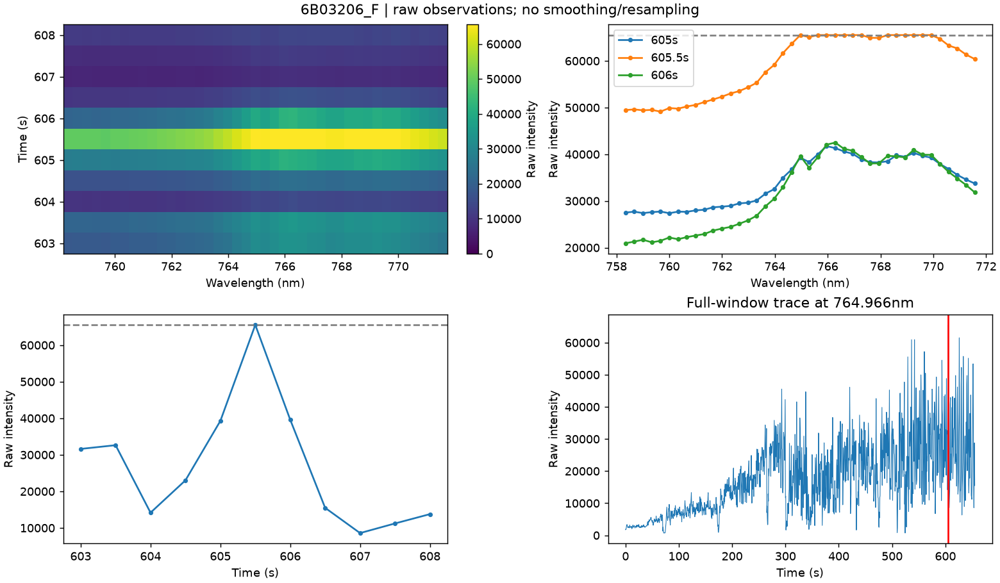

## 10. 持续候选谱峰

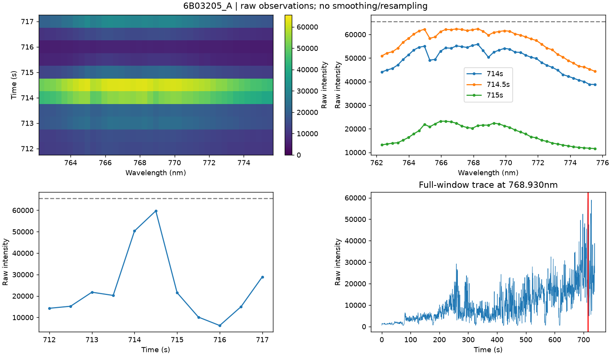

## 11. 低值局部候选，不等于错误

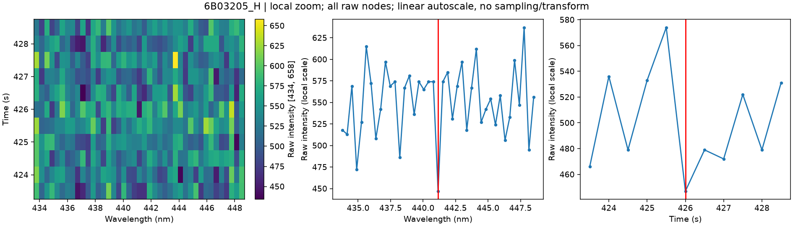

## 12. 快速整谱变化候选

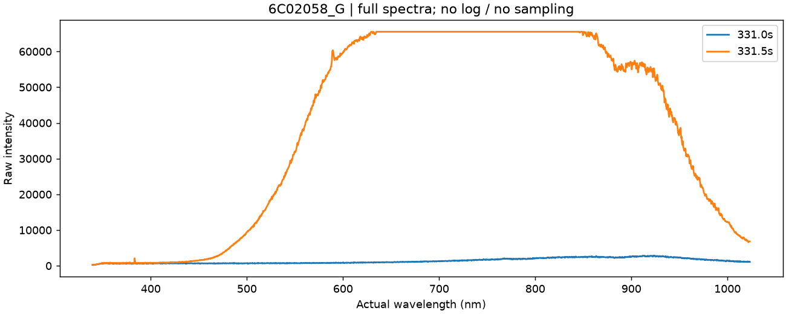
